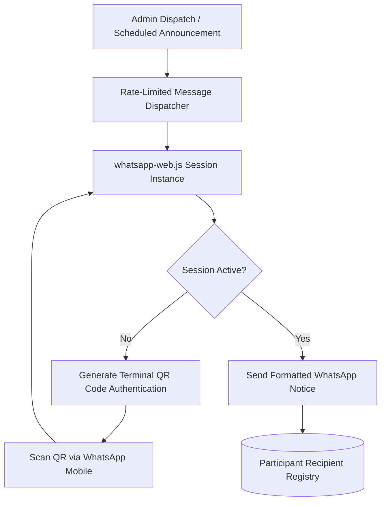

# Piravi Event WhatsApp Bot

<div align="center">

[](https://nodejs.org)
[](https://wwebjs.dev)
[](https://docker.com)
[](LICENSE)

</div>

An automated event notification and messaging bot containerized with Docker, built using the `whatsapp-web.js` library for campus festival event updates and participant announcements.

---

## Event Notification Flow



---

## Features

- **Terminal QR Authentication**: Authenticate directly from the CLI or Docker logs using QR scanning.
- **Rate-Limited Dispatching**: Built-in pacing delays to prevent spam flags and account restrictions.
- **Custom Event Templating**: Dynamic substitution of participant names, event venues, and timings.
- **Dockerized Deployment**: Fully self-contained container with headless Chromium preconfigured.

---

## Tech Stack

| Component | Technology |
| :--- | :--- |
| Runtime | Node.js |
| WhatsApp Library | whatsapp-web.js (Puppeteer & Headless Chromium) |
| Containerization | Docker & Docker Compose |

---

## Getting Started

### Local Setup
1. Clone the repository:
   ```bash
   git clone https://github.com/Midhun-M-git/piravi-bot.git
   cd piravi-bot
   ```

2. Install dependencies:
   ```bash
   npm install
   ```

3. Run the bot:
   ```bash
   npm start
   ```

### Docker Setup
```bash
docker build -t piravi-bot .
docker run -it piravi-bot
```

---

## License

This project is licensed under the MIT License. See the [LICENSE](LICENSE) file for details.
